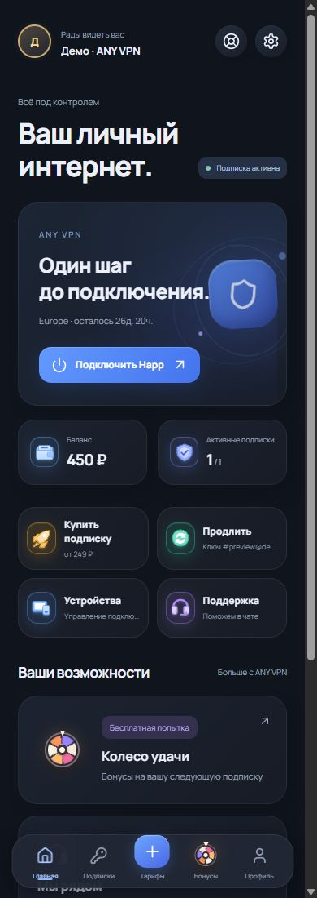
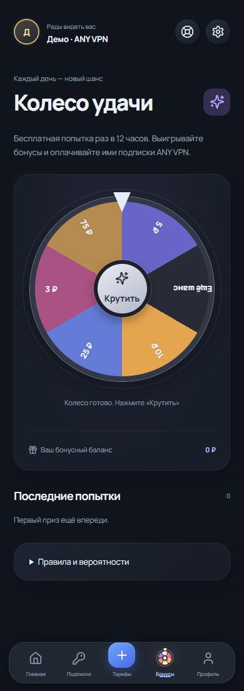
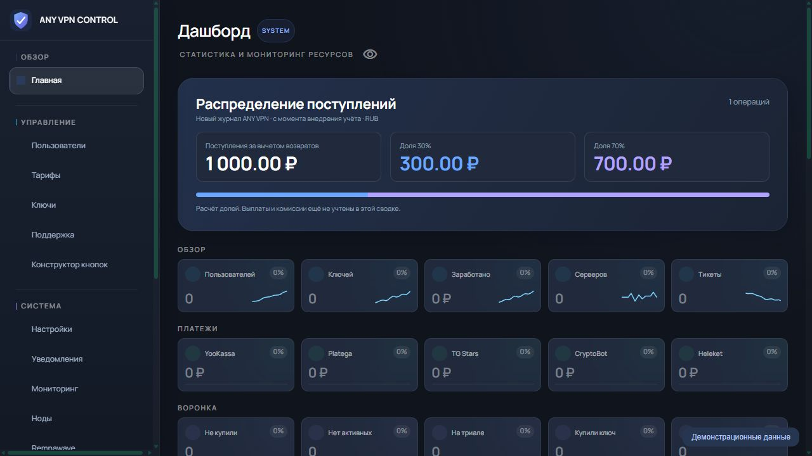

<strong>Один кабинет. Все подключения.</strong> Telegram WebApp · VPN subscriptions · ANY VPN CONTROL

Продукт и инженерная работа <a href="https://github.com/G0d0v">G0d0v</a> Портфолио-кейс · Исходный код закрыт · Предрелизная разработка

---

## Идея

**ANY VPN** объединяет подписки, оплату, устройства и поддержку в одном интерфейсе внутри Telegram. Бот служит точкой входа, WebApp — личным кабинетом, а **ANY VPN CONTROL** — рабочим пространством администратора.

Моя роль: технический администратор бренда и разработчик новой версии. Работа включает ребрендинг, интерфейсы, серверную логику, учёт платежей и подготовку инфраструктуры.

## Интерфейс

Тёмные поверхности, мягкий свет и цветные функциональные иконки. Движение отвечает на действие пользователя: ракета покупки, стрелки продления, устройства и гарнитура поддержки. Маленькое колесо вращается, пока находится на экране. Предусмотрены отключение анимаций и системная настройка reduced motion.

 

Реальные снимки локальной сборки. Все показанные данные — демонстрационные.

## Что реализовано

| Область | Инженерное решение |
| :--- | :--- |
| Личный кабинет | React и TypeScript: подписки, тарифы, кошелёк, история, устройства, поддержка |
| Платежи | Учёт подтверждённых поступлений в копейках, разделение 30/70, защита от повторной обработки |
| Бонусы | Серверный результат рулетки, ограничение попыток и дневного бюджета, отдельный бонусный баланс |
| Авторизация | Проверка Telegram initData, HttpOnly-сессии, хеширование паролей, проверка владельца объектов |
| Подключение | Выдача Happ crypt5 через авторизованный WebApp без открытого URL подписки в интерфейсе |
| Администрирование | Финансовая сводка, пользователи, тарифы, обращения и операции, требующие сверки |
| Motion | SVG-иконки, CSS/WAAPI, остановка циклов вне экрана и в скрытой вкладке |

## ANY VPN CONTROL

Сводка выделяет общий объём поступлений и две доли — 30% и 70%. Расход уже пополненного кошелька не создаёт повторную выручку. Неопределённые результаты внешних операций сохраняются для сверки.

## Стек

**Frontend:** React · TypeScript · Vite · SVG · CSS animations · Web Animations API  
**Backend:** Python · FastAPI · aiogram · Flask  
**Data & infrastructure:** SQLite на текущем этапе · Docker · отдельный API gateway для Remnawave

## Статус и границы кейса

Это демонстрация текущей предрелизной сборки, а не объявление о запущенном сервисе. Локальная сборка и автоматические проверки выполнены. Реальные платежи, импорт Happ на устройствах и развёртывание отдельного gateway требуют проверки в целевом окружении. Полный перенос функций бота и миграция хранилища ещё продолжаются.

Отдельный gateway уменьшает доступ основного сервера к секрету панели только при независимом развёртывании и администрировании. Абсолютная защита секрета от root на его собственном хосте не заявляется.

## О публикации

В репозитории находятся только описание кейса и изображения. Исходники приложения, конфигурация, базы, пользовательские данные и секреты не публикуются.

Новая версия разработана G0d0v на основе существующего проекта; применимые уведомления исходных авторов сохраняются в закрытой рабочей копии. В интерфейсе используются Lucide и Kubai Icons с соблюдением их лицензий.

<a href="https://github.com/G0d0v">G0d0v</a> · Software · Infrastructure · Product engineering

