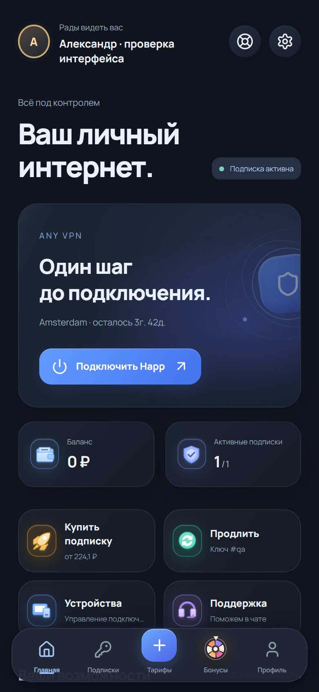
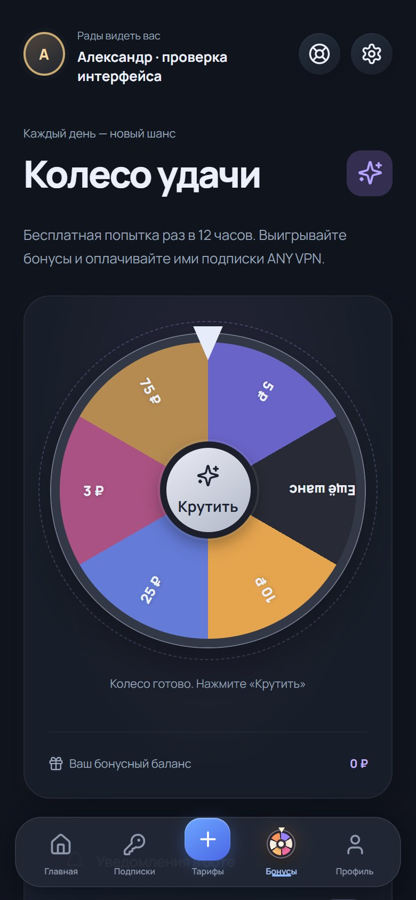
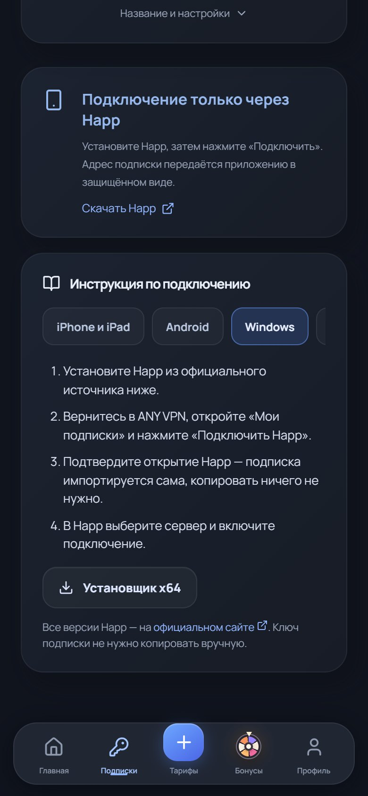
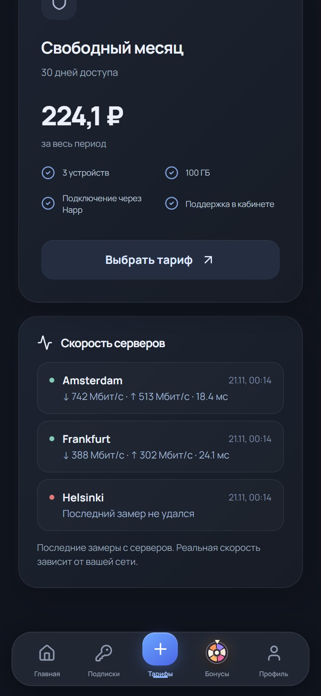
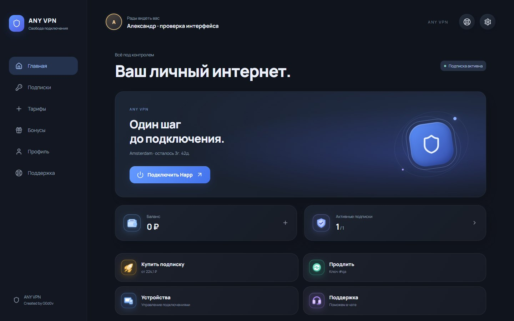
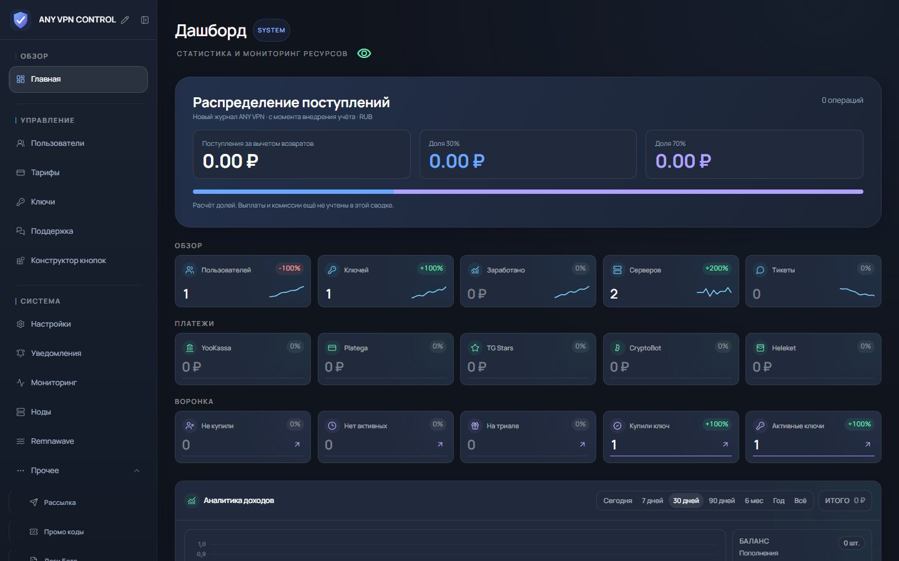

  

  <a href="https://g0d0v.github.io/any-vpn-showcase/"><b>Открыть страницу кейса →</b></a>

  
  
  
  
  

---

**ANY VPN** — сервис VPN-подписок, где всё клиентское происходит в одном красивом кабинете внутри Telegram: покупка, продление, устройства, бонусы, поддержка и подключение в один тап через Happ. **ANY VPN CONTROL** — рабочее место администратора с честной финансовой сводкой и очередями сверки.

Продукт, интерфейсы, серверная логика и инфраструктура новой версии — **[G0d0v](https://github.com/G0d0v)**.

## Интерфейс

<table>
  <tr>
    <td align="center" width="25%"> <b>Главная</b> статус, баланс, быстрые действия</td>
    <td align="center" width="25%"> <b>Колесо бонусов</b> серверный результат, лимит 12 ч</td>
    <td align="center" width="25%"> <b>Подключение</b> только Happ, по платформам</td>
    <td align="center" width="25%"> <b>Серверы</b> последние замеры скорости</td>
  </tr>
</table>

Реальные снимки сборки. Все данные на снимках — демонстрационные.

## Что внутри

| | Решение |
| :-- | :-- |
| 🧭 **Кабинет** | React 19 + TypeScript: подписки, тарифы, кошелёк, история, устройства, поддержка с вложениями, смена локации |
| 🔐 **Подключение** | Только `happ://crypt5/…` из авторизованного WebApp — без открытой ссылки подписки и QR |
| 💳 **Платежи** | Учёт в копейках, идемпотентные счета, сверка суммы и транзакции провайдера, доля 30/70 только с реальных поступлений |
| 🛡 **Оплаченные права** | Продление не снижает купленные устройства до конца срока, не дублирует пакеты трафика и ничего не списывает неявно |
| 🎁 **Бонусы и промо** | Колесо с серверным результатом и бюджетом, отдельный бонусный баланс, резерв промокодов до оплаты |
| 🤝 **Партнёры** | Персональные условия, тестовые ключи с резервом квоты и сверкой по метке заказа |
| 🗄 **Данные** | PostgreSQL 18, перенос SQLite со сверкой хешей строк, учения бэкапа и восстановления, план отката |
| 🧱 **Эксплуатация** | Docker non-root и read-only, приватная сеть БД, HTTPS, мониторинг здоровья и свежести бэкапов |

## ANY VPN CONTROL

Сводка показывает реальные поступления и две доли — 30% и 70%. Трата уже пополненного баланса не создаёт повторную выручку. Неясные исходы внешних операций не повторяются вслепую, а попадают оператору на сверку.

## Инженерные принципы

- **Никаких догадок о деньгах.** Платёж засчитывается только при точном совпадении суммы, валюты и транзакции; неизвестный результат — сверка, а не повтор.
- **Права клиента важнее удобства кода.** Оплаченное не исчезает при продлении, переносе локации или сбое панели.
- **Честные границы безопасности.** Секрет панели можно вынести на отдельный шлюз; абсолютная защита секрета от root на его же хосте не заявляется.
- **Движение с уважением к пользователю.** Анимации останавливаются вне экрана и в фоне, reduced motion соблюдается.

## О публикации

Здесь только описание кейса и изображения. Исходный код, конфигурация, базы данных, пользовательские данные и секреты не публикуются. Новая версия создана G0d0v на основе существующего проекта; уведомления исходных авторов сохранены в закрытой рабочей копии. Иконки — Lucide и Kubai Icons по их лицензиям.

<a href="https://github.com/G0d0v">G0d0v</a> · Product · Software · Infrastructure

